<div align="center">

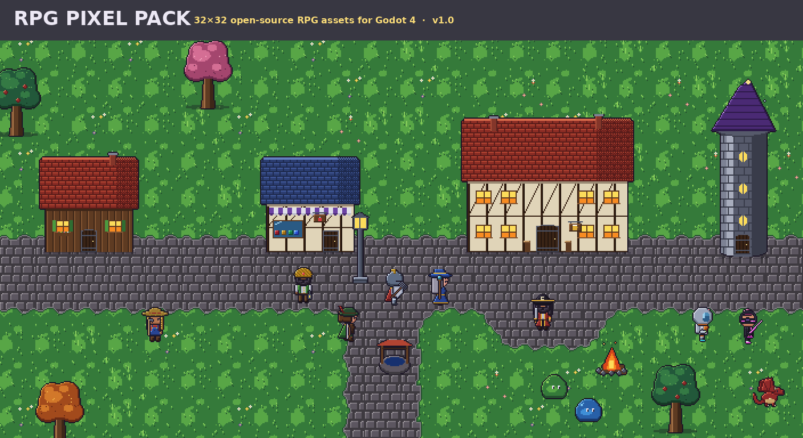

# RPG Pixel Pack

**An open-source 32×32 pixel-art RPG content pack for Godot 4: layered characters, monsters, biomes, buildings, interiors and furniture, plus working Godot systems to use them.**

[](https://jaigod.github.io/rpg-pixel-pack/)
[](https://github.com/JaiGod/rpg-pixel-pack/releases/tag/v1.0)
[](https://godotengine.org/)
[](LICENSE)
[](LICENSE)

[**▶ Play the web demo**](https://jaigod.github.io/rpg-pixel-pack/) ·
[Character Creator](https://jaigod.github.io/rpg-pixel-pack/#creator) ·
[Gallery](https://jaigod.github.io/rpg-pixel-pack/#gallery) ·
[Godot setup guide](docs/GODOT_SETUP.md) ·
[Customization guide](docs/CUSTOMIZATION.md) ·
[Asset reference](docs/ASSET_REFERENCE.md)

</div>

---

## Asset counts

| Category | Count | What you get |
|---|---:|---|
| 🧙 **Character presets** | **52** (104 sheets) | 13 classes × 4 variants, each **male + female**, 18 animations |
| 🧩 **Customization layers** | **180 sheets** | 6 skin tones · 12 hair styles (8 colors) · 14 torso · 8 legs · 15 headgear · 6 accessories · 2 capes · 20 weapons · 6 off-hands, all for both body types |
| 👾 **Monsters** | **76** | slimes, skeletons, goblins, orcs, dragons, robots, aliens, shadow creatures, **8 animated 64×64 bosses** |
| ⚔️ **Equipment** | **62** | swords, axes, spears, bows, crossbows, staves, wands, shields, helmets, capes, armor sets (+ Godot `ItemData` resources) |
| 🌲 **Environments** | **11 tilesets + 20 props** | village, forest, desert, swamp, snow, dungeon, castle, ruins, space colony, research lab, cyber city, each with Godot terrain auto-tiling |
| 🏠 **Homes & buildings** | **40** | small/large houses, inns, shops, farms, blacksmiths, wizard towers, castles, space habitats, futuristic apartments |
| 🛋️ **Interiors** | **35 rooms** + tileset | bedrooms, kitchens, taverns, workshops, libraries, laboratories, command centers |
| 🪑 **Furniture** | **120** | tables, beds, chairs, shelves, crates, barrels, computer stations, consoles, 52 decorations |
| 🔥 **Environmental animations** | **21** | water, lava, waterfall, fire, torches, doors, portals, chest, flags, windmill, coin and more |
| **Total** | **437 headline assets · 684 PNGs** | one shared 348-color palette, 32×32 grid, clean outlines, top-left lighting |

Everything is regenerated from source by [`tools/generate_all.py`](tools/generate_all.py), so you can change the palette, add a hair style or a new monster and rebuild the whole pack.

## Screenshots

### Characters: 52 presets, male + female
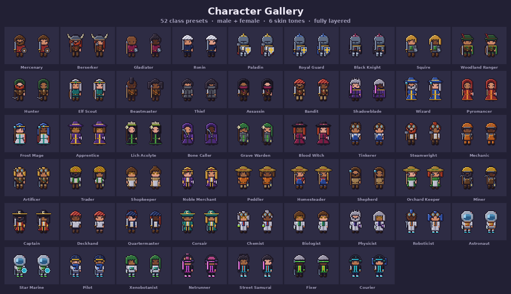

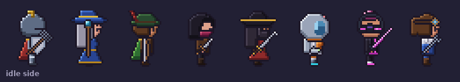

*Each character has idle, walk, run, attack, hurt and death animations in 3 directions (down / up / side, flipped for left).*

### Customization system
| Mix & match layers | Palette swap |
|---|---|
| 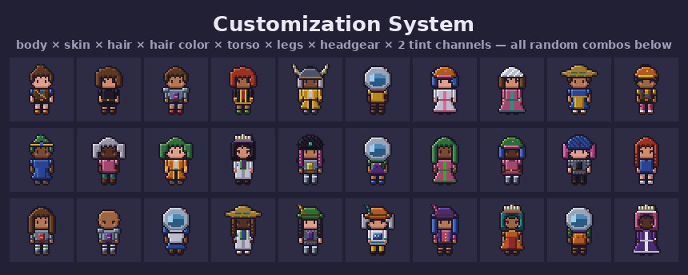 | 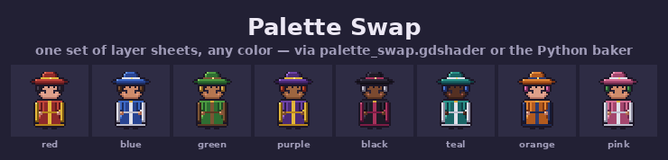 |

### Monsters
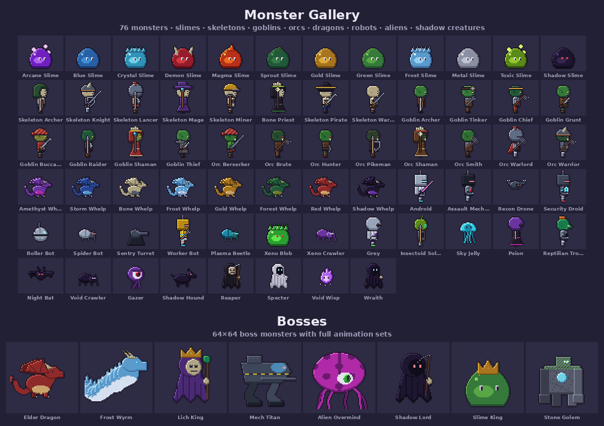

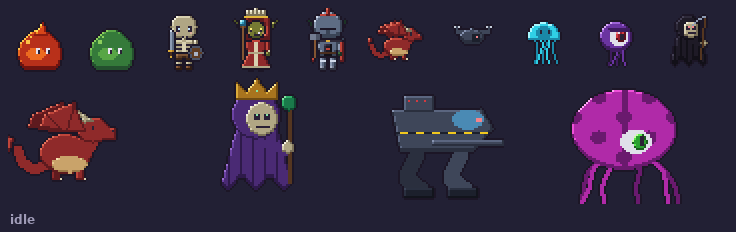

### Equipment
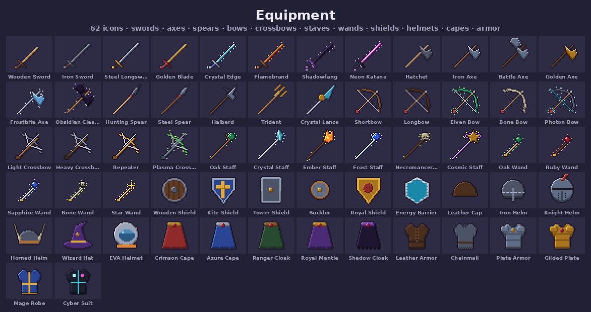

### Buildings
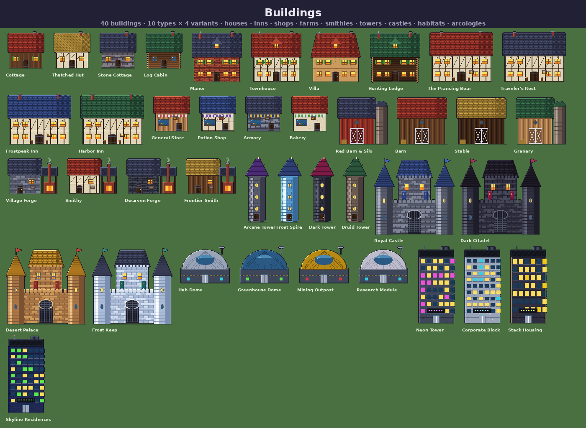

### Environments
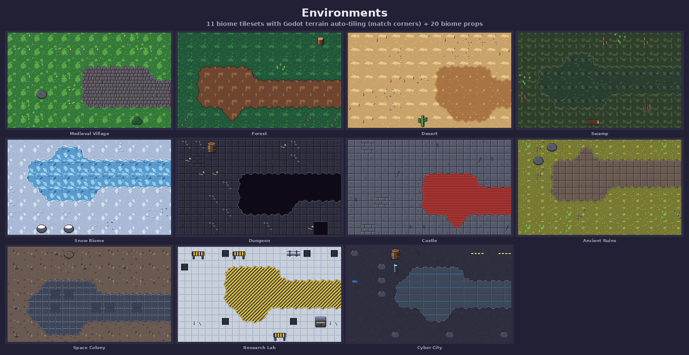
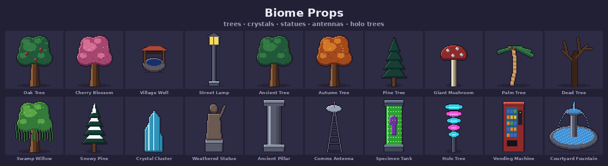

### Interiors
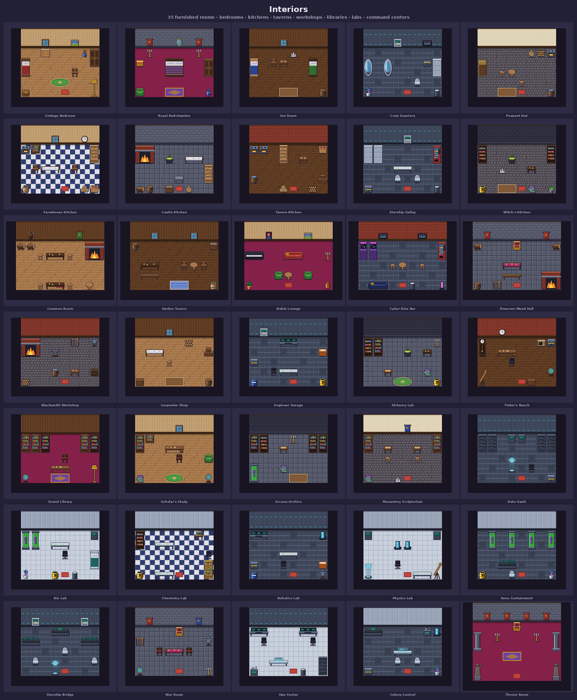

### Furniture
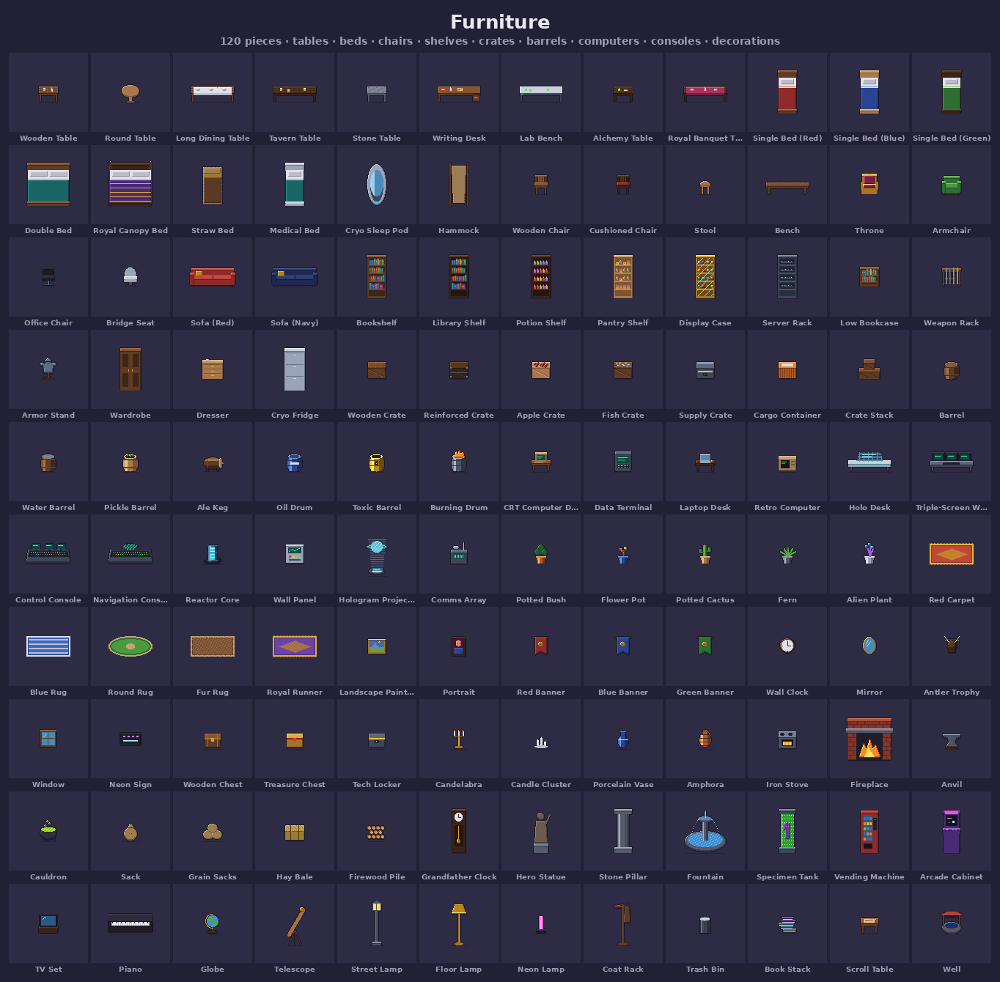

### Environmental animations
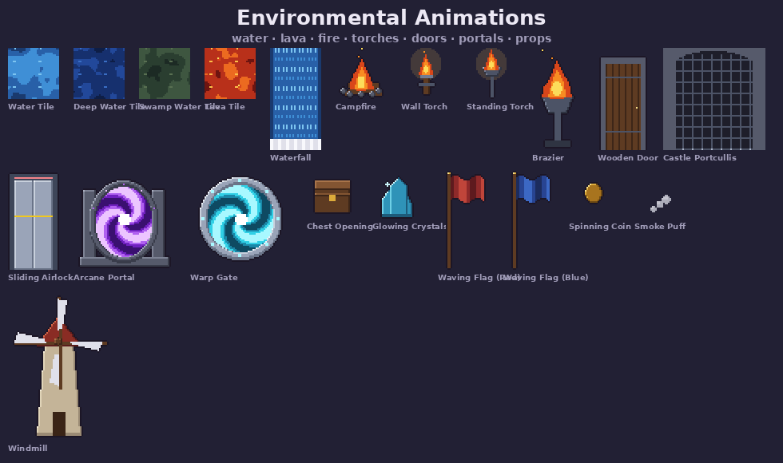

---

## Installation

### Option A: run the demo project
1. Install **[Godot 4.3 or newer](https://godotengine.org/download)** (standard build; no C#/.NET needed).
2. Clone or [download](https://github.com/JaiGod/rpg-pixel-pack/archive/refs/heads/main.zip) this repo.
3. In the Godot Project Manager click **Import** and select `godot_project/project.godot`.
4. Press **F5**. The demo menu opens: *Village*, *Character Creator*, *Inventory & Equipment*, *Interiors*, *Asset Gallery*. **Esc** returns to the menu.

### Option B: add the pack to your own game
Copy the folder **`godot_project/rpg_pixel_pack/`** into the root of your Godot project (it must stay at `res://rpg_pixel_pack/`). Then:

1. **Project Settings → Rendering → Textures → Default Texture Filter = `Nearest`** (crisp pixels).
2. Optional: **Display → Window → Stretch → Mode = `canvas_items`**, viewport `640×360`.
3. To use the demo input actions, add `res://rpg_pixel_pack/scripts/input_setup.gd` as an **Autoload**, or create `move_left/right/up/down`, `run`, `attack`, `interact` in the Input Map.
4. When exporting, add `*.json` to **Export → Resources → Filters to export non-resource files** (the catalogs are read at runtime).

Full walkthrough: **[docs/GODOT_SETUP.md](docs/GODOT_SETUP.md)**

## Godot setup guide (quick version)

| Feature | Where | How |
|---|---|---|
| `AnimatedSprite2D` frames | `rpg_pixel_pack/resources/frames/` | 104 character + 76 monster + 21 animation `SpriteFrames` `.tres`, ready to drop into `sprite_frames` |
| TileMaps | `rpg_pixel_pack/resources/tilesets/*.tres` | 11 biome `TileSet`s with a **Match Corners terrain set** (paint with the terrain tool) and collision on obstacle tiles, plus an interior TileSet with wall collision |
| Layered characters | `prefabs/layered_character.tscn` | `LayeredCharacter` node: set layers + palette ramps from code or the Inspector |
| Player | `prefabs/player.tscn` | `PlayerController` (`CharacterBody2D`): walk / run / attack / interact, with `EquipmentComponent` + `Camera2D` |
| NPC | `prefabs/npc.tscn` | `NPCController`: wanders, faces you, speech bubble on **E** |
| Monster | `prefabs/monster.tscn` | `MonsterController`: set `monster_id`, wander → chase → attack → hurt → death |
| Inventory | `scripts/inventory.gd`, `inventory_ui.gd` | `Inventory` resource + `InventoryUI` panel (click to equip/unequip) |
| Equipment | `scripts/equipment.gd`, `resources/items/*.tres` | 62 `ItemData` items; equipping swaps the character's visual layers and totals stats |
| Palette swap | `shaders/palette_swap.gdshader` | recolors any tintable layer to any ramp (two channels), plus a hit-flash uniform |

## Usage examples

**Drop a baked character into a scene**
```gdscript
var hero := AnimatedSprite2D.new()
hero.sprite_frames = load("res://rpg_pixel_pack/resources/frames/characters/knight_paladin_female.tres")
hero.play("walk_down")          # idle|walk|run|attack|hurt|death  ×  down|up|side
add_child(hero)
```

**Build a custom character from layers**
```gdscript
var c := LayeredCharacter.new()
c.sex = "female"
add_child(c)
c.set_layer("body", "skin_brown")
c.set_hair("braids", "hair_red")
c.set_layer("torso", "plate", "cloth_blue", "cloth_yellow")   # style, primary ramp, secondary ramp
c.set_layer("legs", "greaves")
c.set_layer("head", "knight_helm", "cloth_red", "cloth_red")
c.set_layer("cape", "cape", "cloth_blue", "gold")
c.set_layer("weapon", "spear")
c.set_layer("offhand", "kite_shield", "cloth_blue", "cloth_yellow")
c.face(Vector2.LEFT)
c.play_anim("run")
```

**Equip items**
```gdscript
var inv := Inventory.new()
inv.load_items(PackedStringArray(["sword_flame", "helmet_knight", "armor_plate", "cape_royal"]))
$Player/Equipment.equip(inv.slots[0])           # character visibly switches weapon
print($Player/Equipment.total("attack"))
```

**Paint a biome map**
```gdscript
var ground := TileMapLayer.new()
ground.tile_set = load("res://rpg_pixel_pack/resources/tilesets/forest.tres")
add_child(ground)
var corners := RPGTerrain.empty_corners(40, 24)
RPGTerrain.fill_rect(corners, Rect2i(0, 11, 40, 1))            # a dirt road
RPGTerrain.fill_ellipse(corners, Vector2(20, 12), Vector2(5, 3)) # a clearing
RPGTerrain.paint(ground, corners)
```

**Spawn a monster / load an interior**
```gdscript
var slime: MonsterController = preload("res://rpg_pixel_pack/prefabs/monster.tscn").instantiate()
slime.monster_id = "boss_slime_king"
add_child(slime)

var room := RoomLoader.new()
room.room_id = "tavern_common"     # any of the 35 rooms in interiors/interiors.json
add_child(room)
```

More in **[docs/CUSTOMIZATION.md](docs/CUSTOMIZATION.md)** and **[docs/ASSET_REFERENCE.md](docs/ASSET_REFERENCE.md)**.

---

## Repository structure

```
rpg-pixel-pack/
├── assets/          palette (.png/.gpl/.hex/ramps.json), palette-swap keys, UI kit
├── characters/      layers/<male|female>/<layer>/<style>.png · presets/<class>/*.png · characters.json
├── monsters/        <family>/<id>.png · monsters.json
├── equipment/       <category>/<id>.png · equipment_atlas.png · equipment.json
├── buildings/       <type>/<id>.png · buildings.json (collision + door tile)
├── environments/    tilesets/<biome>.png · props/*.png · environments.json
├── interiors/       tileset/ · rooms/<category>/<id>.png + .json layouts · interiors.json
├── furniture/       <category>/<id>.png · furniture.json
├── animations/      <category>/<id>.png (horizontal strips) · animations.json
├── demo/            web/ (browser demo source) + notes on the Godot demo scenes
├── docs/            GitHub Pages site (playable demo) + guides
├── previews/        README screenshots, galleries, GIFs
├── godot_project/   Godot 4 project: rpg_pixel_pack/ (drop-in pack) + demo/ scenes
├── tools/           Python generator that draws every asset (source of truth)
├── LICENSE
└── README.md
```

## Art style
* **32×32 grid** for characters, tiles, items and furniture (buildings and bosses are multiples of 32).
* **One shared palette**: 86 four-shade ramps / 348 colors ([`assets/palette`](assets/palette)), also as a GIMP/Aseprite `.gpl`.
* **Clean 1-px outlines** (`#1c1626`) on sprites, outline-free tiles, **light from the top-left** everywhere.
* **3/4 top-down** perspective for buildings and furniture (works for Stardew Valley / RPG Maker / Rune Factory / MMO-style games).

## Regenerating the pack
```bash
pip install pillow numpy
python tools/generate_all.py          # ~15 s: all PNGs, metadata, previews, Godot resources, web demo
python tools/validate_godot.py        # static check of every res:// reference in the Godot project
```
The generator is plain Python ([`tools/rpgpack/`](tools/rpgpack)): add a hair style in `characters.py`, a monster in `monsters.py`, a biome in `environments.py`, then rebuild.

## Website (GitHub Pages)
The playable demo lives in [`docs/`](docs) and is served at **https://jaigod.github.io/rpg-pixel-pack/**. It runs on the same PNGs: a walkable village (talk to NPCs, fight slimes), a character creator that exports a full sprite sheet, and an animated gallery. To host your own fork: **Settings → Pages → Deploy from a branch → `main` / `/docs`**.

## License
* **Art** (all PNG/GIF files): **[CC0 1.0](https://creativecommons.org/publicdomain/zero/1.0/)**. Public domain, use it in commercial games with no attribution required (credit appreciated!).
* **Code** (GDScript, shader, Python tools, web demo): **MIT**.

See [LICENSE](LICENSE).

## Credits & links
Created by **Jaineil Rana (JaKing)**. Part of the [JaiGod](https://github.com/JaiGod) projects.

* 💼 LinkedIn: [linkedin.com/in/jaineil-rana-89005736a](https://www.linkedin.com/in/jaineil-rana-89005736a)
* ❤️ Support new packs & games on Patreon: [patreon.com/c/JaineilRana](https://www.patreon.com/c/JaineilRana)
* 🎮 Godot Engine: [godotengine.org](https://godotengine.org)

If you ship something with this pack, open an issue with a screenshot. I'd love to see it!
